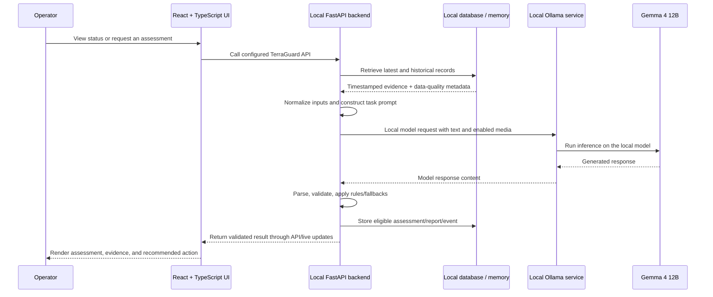
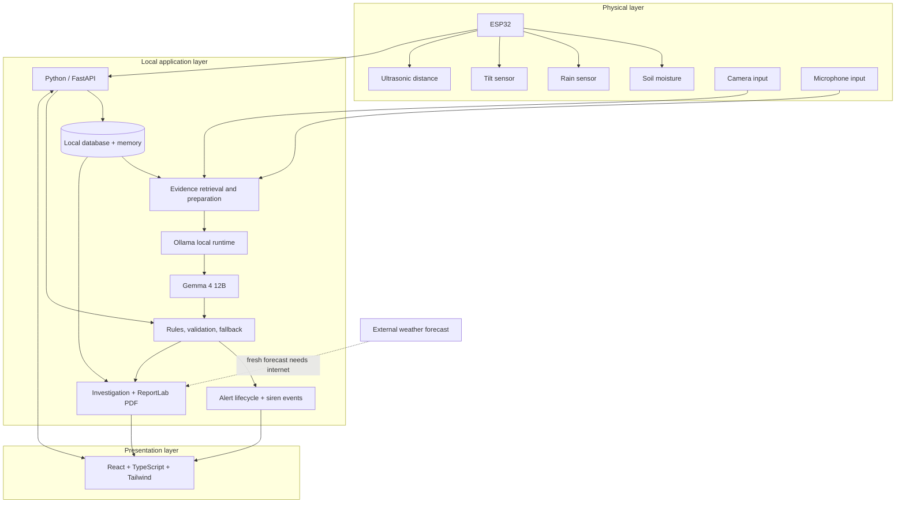
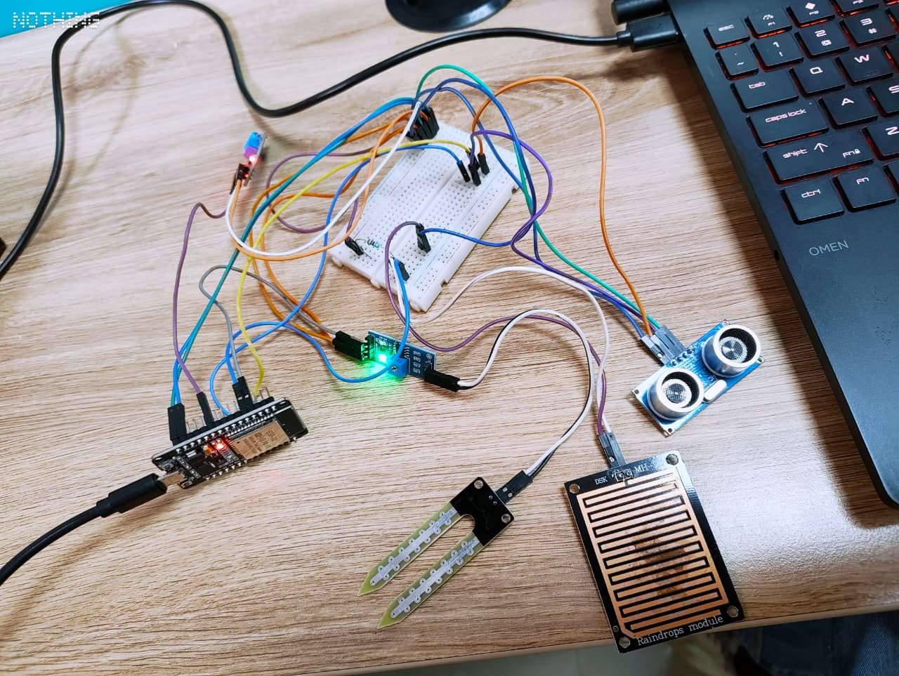
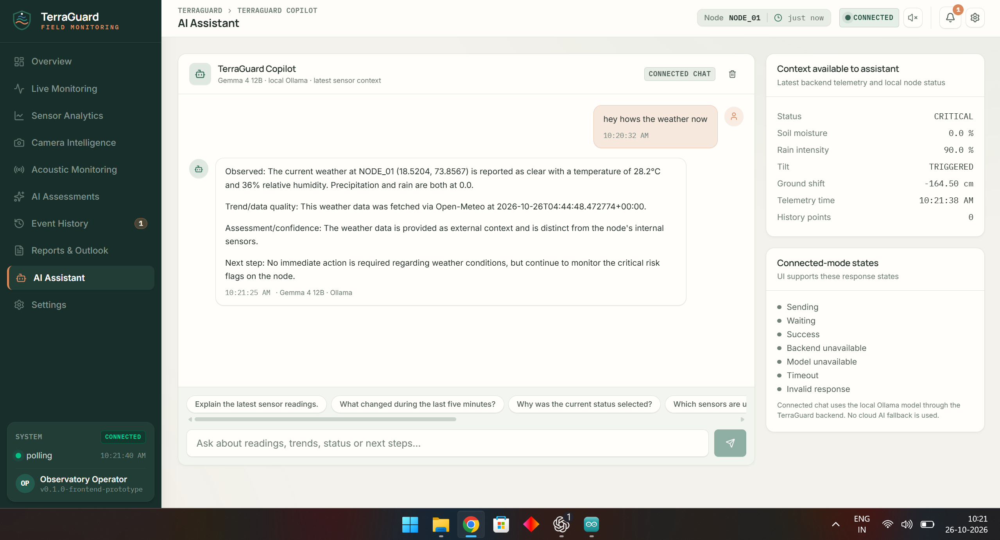
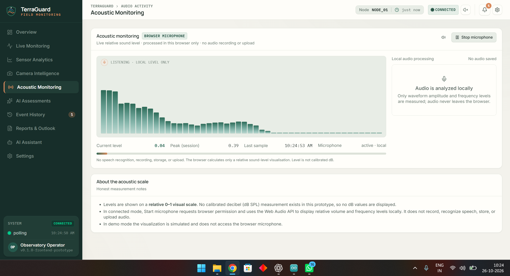
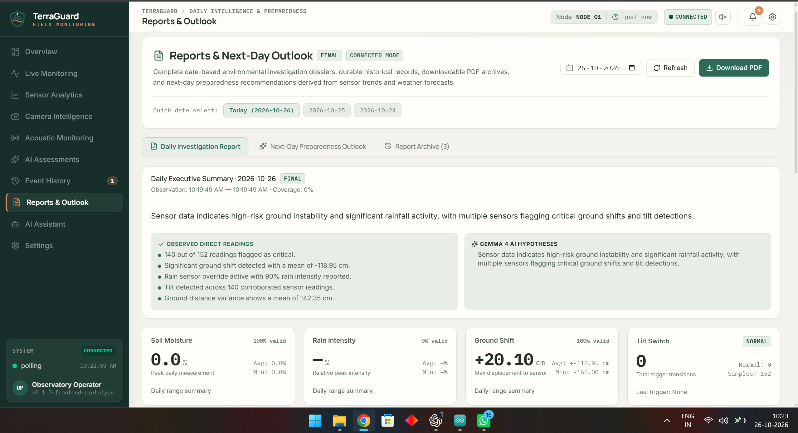
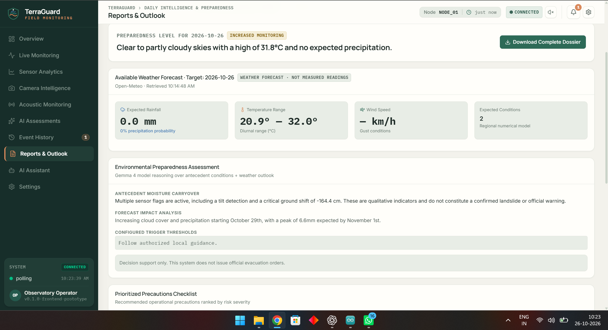
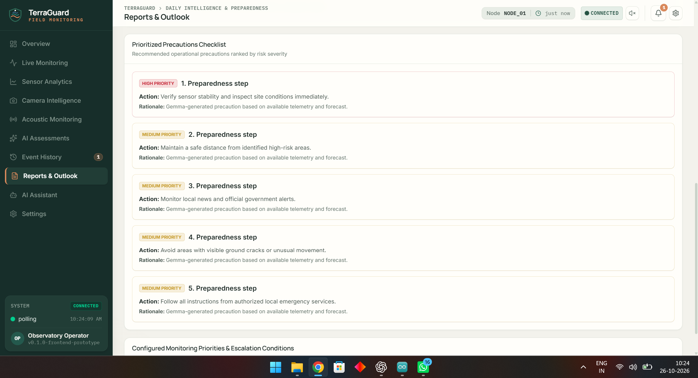

<div align="center">

# 🌿 TerraGuard

### Local AI-Powered Environmental Monitoring & Landslide Investigation

**From disconnected environmental signals to contextual, evidence-backed investigation — powered by Gemma 4 running locally.**

[](https://ai.google.dev/gemma/docs/core/model_card_4)
[](https://ollama.com/library/gemma4)
[](https://fastapi.tiangolo.com/)
[](https://react.dev/)
[](https://www.typescriptlang.org/)

**Built by Bakchod Engineers** · **Working physical prototype** · **Local-first AI**

[Problem](#-the-problem) · [Solution](#-the-terraguard-approach) · [Gemma 4 deep dive](#why-gemma-4-is-a-strong-fit-for-this-project) · [Model data flow](#how-the-frontend-backend-ollama-and-gemma-4-communicate) · [Architecture](#-system-architecture) · [Capabilities](#-what-the-prototype-does) · [Limitations](#-honest-limitations-and-how-we-plan-to-address-them)

</div>

---

> [!IMPORTANT]
> **TerraGuard is an environmental monitoring and investigation prototype, not a certified landslide prediction system or an official public-warning service.** It combines sensor observations, historical context, model-assisted interpretation, and rule-based safeguards to support human investigation. It does not claim validated landslide-prediction accuracy, and it must not replace official alerts, qualified geotechnical assessment, or emergency procedures.

## 📌 At a glance

| | TerraGuard |
|---|---|
| **Mission** | Help people inspect changing hillside conditions with more context, traceability, and preparedness. |
| **Physical input** | ESP32, soil-moisture sensor, rain sensor, tilt sensor, ultrasonic distance sensor, camera, and microphone. |
| **AI core** | Google Gemma 4 12B Unified, served locally through Ollama; open-weight model under Apache 2.0. |
| **AI role** | Contextual multi-sensor interpretation, structured JSON assessments, historical investigation, multimodal inputs on enabled paths, daily report synthesis, and next-day preparedness. |
| **Safety design** | Model-output validation, configured deterministic rules, fallback handling, and severity-aware alerts. |
| **Frontend** | React, TypeScript, Tailwind CSS. |
| **Backend** | Python, FastAPI. |
| **Local records and reports** | Local database/application memory and daily PDF reporting with ReportLab. |
| **Network dependency** | Fresh external weather forecasts require internet; local inference does not require a hosted LLM API. |
| **Team** | Bakchod Engineers — Adnan Nagariya and Tatwa Shahare. |

## 🚀 Run TerraGuard locally

### Backend

From the repository's `backend/` directory:

```powershell
python -m venv .venv
.\.venv\Scripts\Activate.ps1
pip install -r requirements.txt
Copy-Item .env.example .env
uvicorn backend.app:app --reload --host 0.0.0.0 --port 8000
```

Configure Ollama and backend variables in `backend/.env.example` as needed.

### Frontend

From `frontend/` in a second terminal:

```powershell
npm install
npm run dev
```

Set `VITE_TERRAGUARD_API_BASE_URL` in `frontend/.env` to the backend URL if they use different origins.

### ESP32 firmware

Open `firmware/esp32/terraguard_node.ino` in Arduino IDE. Copy `firmware/esp32/secrets.example.h` to `secrets.h` in that folder and set local Wi-Fi and server values. The real `secrets.h` is ignored by Git; do not commit credentials.

---

## 🎯 The problem: sensors can measure a change, but people need to understand its context

Hillside and landslide-related monitoring is not simply a matter of displaying numbers. Rainfall, soil moisture, tilt, and changes in measured ground distance can each provide useful evidence—but a single reading rarely explains the complete situation.

A measurement becomes more useful when it can be interpreted alongside **what happened before it, what other sensors reported, whether the data is trustworthy, and what changed afterwards**. When observations, alerts, forecasts, and reports live in separate places, reconstructing the sequence can require manual work at exactly the moment clarity matters.

### The gap TerraGuard targets

- **Isolated readings:** a dashboard can show values, but the operator still needs to connect different signals into a coherent explanation.
- **Limited temporal context:** a current snapshot cannot tell the whole story of how conditions evolved over a day.
- **Alerts without an investigation trail:** an alert is more useful when its source readings, timestamp, assessment, and recommended next step are available together.
- **Ambiguous or incomplete evidence:** missing readings, stale measurements, sensor disagreement, or an unstable baseline can change how an event should be interpreted.
- **Manual reporting overhead:** building a daily timeline, summarising sensor behaviour, and assembling a report can be time-consuming.
- **Disconnected preparedness workflow:** a day's observed conditions and the next day's forecast should be considered together, without confusing forecasts with measurements.
- **Dependence on hosted AI:** sending all evidence to a remote AI service may introduce connectivity, privacy, cost, or availability constraints.

### The design opportunity

The opportunity is not to claim that AI can predict every landslide. It is to **make environmental evidence easier to connect, inspect, explain, preserve, and act on responsibly**. TerraGuard is built around that narrower, practical goal.

## 🧭 The landscape: where TerraGuard fits

TerraGuard is designed to bridge monitoring, investigation, and reporting in one local-first workflow. The table below compares broad solution patterns; it is a design-positioning summary, **not a benchmark of named competitors**. Specific commercial and research systems vary considerably and may offer overlapping features.

| Approach | What it commonly does well | Gap TerraGuard is designed to address |
|---|---|---|
| **Sensor dashboard / threshold monitor** | Live readings, simple status indicators, configured threshold alerts. | Add model-assisted context, a history-aware explanation, event reconstruction, and report synthesis around those observations. |
| **Cloud-connected analytics** | Centralised dashboards, remote access, scalable storage or analytics. | Keep the core inference path and historical records local, with a clearly identified internet dependency for fresh weather data. |
| **General-purpose AI chat** | Flexible question answering and summarisation. | Ground the workflow in specific device readings, retained history, event identifiers, schema validation, and deterministic guardrails. |
| **Manual incident report** | Human judgement and a record of what an operator observed. | Reduce repetitive assembly by collecting available data, trends, timelines, and structured report sections in one workflow. |
| **TerraGuard** | Physical sensing plus local Gemma 4 inference, contextual investigation, alerting, daily reports, and preparedness support. | Still requires broader field validation, formal benchmarks, site-specific calibration, and expert review before safety-critical deployment. |

**Our differentiation is the system design around the model:** local evidence preparation, historical context, structured outputs, deterministic safeguards, traceable events, and useful deliverables—not a claim that no other product has these capabilities.

---

## 🌿 The TerraGuard approach

TerraGuard is a local-first environmental monitoring and investigation prototype built around a physical ESP32 sensor node and a multimodal, locally run AI model.

Rather than treating AI as a separate chatbot, TerraGuard integrates Gemma 4 into an evidence pipeline. The application supplies current sensor readings and relevant historical context, validates the model's structured response, and connects assessments to alerts, event history, daily reports, and next-day preparedness guidance.

### From observation to action

1. **Observe** — the ESP32 reads the connected environmental sensors.
2. **Record** — the backend receives telemetry and retains the available readings locally.
3. **Build context** — the application prepares the latest state alongside a relevant historical evidence summary.
4. **Reason with Gemma 4** — the local model interprets supplied evidence and returns structured assessment content.
5. **Apply safeguards** — the backend validates the response and retains deterministic rules and fallback behaviour for critical application logic.
6. **Communicate** — the UI shows readings, explanations, event evidence, and severity-aware alerts; critical alerts can trigger a local siren.
7. **Investigate** — the system uses available history to examine event sequences, discrepancies, and missing data.
8. **Report** — daily findings are organised into a date-based report, with PDF generation through ReportLab.
9. **Prepare** — where an actual forecast is available, the system creates qualified next-day precautions and monitoring priorities.

```text
PHYSICAL ENVIRONMENT
        │
        ▼
ESP32 + sensors ───────── Camera / microphone inputs
        │                              │
        └──────────────┬───────────────┘
                       ▼
              FastAPI + local records
                       │
            Current + historical evidence
                       │
            ┌──────────▼───────────┐
            │   Local Gemma 4 12B  │
            │ contextual analysis │
            └──────────┬───────────┘
                       │ structured model output
                       ▼
        Validation + deterministic safeguards
                       │
       ┌───────────────┼────────────────┐
       ▼               ▼                ▼
    Alerts       Investigation      Daily report
  + local siren  + history Q&A     + PDF + outlook
       └───────────────┬────────────────┘
                       ▼
             TerraGuard dashboard
```

---

# 🧠 Gemma 4: the open-weight AI engine at the centre of TerraGuard

> **Gemma 4 is the core interpretation engine in TerraGuard—not a decorative chatbot.** It receives evidence prepared by the backend, interprets relationships across sensor readings and available history, produces structured assessment content, and helps turn technical evidence into explanations, investigations, and daily preparedness reports. The application—not the model alone—remains responsible for data integrity, validation, deterministic safety rules, persistence, and alert lifecycle.

TerraGuard runs **Google Gemma 4 12B locally through Ollama**. Gemma 4 is an open-weight model family from Google DeepMind, released under the **Apache 2.0 license** according to the official model card. The 12B Unified model accepts text, image, and audio input and has a documented context window of up to 256K tokens. These are model capabilities; the exact inputs and functions available in TerraGuard depend on the application pipeline, runtime version, and hardware. See the [official Gemma 4 model card](https://ai.google.dev/gemma/docs/core/model_card_4), [Google's Gemma 4 12B developer guide](https://developers.googleblog.com/gemma-4-12b-the-developer-guide/), and [Ollama's Gemma 4 library](https://ollama.com/library/gemma4).

<div align="center">

| **Model** | **Runtime** | **Modalities supported by the 12B variant** | **Context window documented by Google** | **License shown on model card** |
|:---:|:---:|:---:|:---:|:---:|
| **Gemma 4 12B Unified** | Ollama, local | Text · Image · Audio | Up to **256K tokens** | **Apache 2.0** |

</div>

*Model specifications above describe Gemma 4 12B generally. They are not TerraGuard performance benchmarks, and they do not imply that every modality has been independently validated for environmental hazard detection.*

## Why TerraGuard needs an AI model—not only fixed thresholds

Rules and AI solve different parts of the problem. A fixed rule is excellent at checking an exact condition consistently. It is less suited to writing a grounded narrative that connects several observations, compares a current event with historical context, explains disagreement, identifies unanswered questions, and turns a long day of data into a readable report.

TerraGuard combines both approaches deliberately:

| Need | What conventional code does best | What Gemma 4 contributes |
|---|---|---|
| **Exact measurement handling** | Parse units, retain timestamps, calculate numeric deltas, validate ranges, and preserve missing values. | Explain the significance of the supplied values in context. |
| **Configured safety rules** | Apply explicit thresholds and deterministic conditions consistently. | Provide supporting interpretation and explain the evidence packet. It must not override the configured safety layer. |
| **Many sensor signals** | Collect, align, and validate readings from different sources. | Synthesise relationships among the supplied soil-moisture, rain, tilt, ground-distance, and historical evidence. |
| **Changing conditions** | Query stored records and calculate trends or event intervals. | Describe the sequence and compare what changed before, during, and after an event. |
| **Incomplete or inconsistent evidence** | Mark nulls, stale values, invalid measurements, and collection gaps. | Explain why those gaps matter and identify what remains uncertain, based on the supplied metadata. |
| **Daily reporting** | Calculate statistics, render charts, arrange event records, and generate a PDF. | Draft coherent summaries, incident narratives, findings, and qualified recommendations from the prepared evidence. |
| **Natural-language investigation** | Retrieve the relevant records and enforce access boundaries. | Answer questions about the retrieved evidence in understandable language. |

The AI component is valuable because environmental investigation involves more than triggering a threshold: it involves **interpreting evidence without confusing interpretation with proof**. Gemma 4 gives TerraGuard a flexible language-and-reasoning layer over data that conventional code still collects, calculates, and validates.

## Why Gemma 4 is a strong fit for this project

Gemma 4 is a strong fit for TerraGuard because its documented feature set aligns with the project's local, evidence-heavy workflow. The following describes the model's published capabilities and why they matter to our architecture; it does not imply every capability is used in every request.

### 1. A capable model that can run inside a local application

TerraGuard needs its interpretation layer near the locally stored environmental data, instead of requiring every assessment to be sent to a hosted LLM service. Gemma 4 can be downloaded and served locally, and Ollama provides a local interface for requesting model responses. Once the model and software dependencies are present, model inference does not require a paid hosted-LLM API or a cloud fallback.

This enables a practical deployment pattern: sensor data is received by the local backend, the backend assembles an evidence packet, the local model interprets it, and the application validates and displays the result. **Local inference reduces dependence on an external AI provider; it does not remove the need for suitable hardware, local service availability, or responsible device security.**

### 2. Multimodal understanding: text, images, and audio

The Gemma 4 12B Unified variant supports text, image, and audio inputs. This matters to TerraGuard because an environmental event can be described by structured telemetry, visual context captured by a camera, or audio captured through a microphone—not just a typed question.

Google's developer guide describes the 12B variant's unified, encoder-free multimodal architecture: image and audio inputs are projected into the model's shared representation instead of requiring the same kind of separate, multi-stage encoders used by other multimodal designs. That architecture is a model-level design choice; end-to-end latency still depends on hardware, input size, runtime implementation, and application preprocessing.

In TerraGuard, the intended multimodal flow is bounded and evidence-driven:

- **Text and structured context** establish readings, units, timestamps, event history, and the question being investigated.
- **Image input**, when captured and passed through the enabled path, can supply additional visual context. It is not automatically a certified landslide detector.
- **Audio input**, when captured and passed through the configured model-compatible path, can provide acoustic context. It is not automatically a validated continuous landslide-sound classifier.
- **Historical summaries** put individual measurements in temporal context and help the model explain change rather than respond to a single isolated value.

Model capability is not the same as proven application capability. TerraGuard only presents an input as used when that input is actually captured, routed to the local backend/model, and returned through a working, testable path.

### 3. Long-context capability for evidence-rich tasks

Google documents a context window of up to 256K tokens for the 12B variant. A large context window can make long evidence packets and multi-document tasks feasible, but it is not a reason to send every stored sensor sample to every request.

TerraGuard's backend remains responsible for selecting an appropriate time window, preparing summaries, retaining source timestamps, and limiting the model input to relevant evidence. The model's maximum context is a ceiling, not a guarantee of perfect recall, infinite memory, or faster inference. The length of the available context depends on the runtime and configuration, while answer quality depends on evidence quality and prompt design.

### 4. Reasoning-oriented behaviour and configurable thinking modes

The official Gemma 4 model card describes configurable thinking modes and reasoning-oriented capabilities. TerraGuard applies the model to bounded investigation tasks: compare supplied evidence, describe relevant relationships, identify contradictions or data gaps, formulate a structured interpretation, and produce a cautious next step.

The project does **not** rely on exposing a model's hidden internal reasoning transcript as proof. Instead, its user-facing result should provide an understandable summary, the evidence used, the limitations, and a recommended action. This is more useful for an environmental operator and easier to audit than a long, unverified internal monologue.

A conceptual interpretation sequence is:

1. **Orient:** identify the event/question, observation interval, and available sources.
2. **Compare:** inspect the sensor readings and historical context provided in the evidence packet.
3. **Identify support:** summarise which supplied observations support a possible interpretation.
4. **Identify uncertainty:** note missing values, stale readings, contradictory evidence, and alternative explanations when these are represented in the input.
5. **Synthesize:** produce the configured response fields or requested report section.
6. **Constrain:** avoid claiming that correlation proves a landslide, do not invent missing readings or forecasts, and state when evidence is insufficient.
7. **Validate:** let the backend parse and validate the output and apply its independent rules and fallbacks before the UI treats it as an assessment.

This is the **application's reasoning workflow**, not a claim that the model follows these steps perfectly on every generation. Generated content must still be checked, and formal quality and safety evaluation remains ongoing.

### 5. Structured generation instead of unbounded chat text

TerraGuard asks Gemma 4 for structured assessment content that the rest of the application can consume. A known schema makes it possible to display risk level, summary, recommended action, and supporting metadata in consistent UI components. It also makes bad responses detectable.

The backend must treat model responses as untrusted output: parse the returned content, verify required fields and allowed categories, reject malformed or incomplete payloads, and use its fallback path when needed. A valid JSON document is not automatically a correct assessment; schema validation checks shape and allowed values, not scientific truth.

### 6. Model versatility across monitoring, investigation, and reporting

A single local model family can support different language-oriented tasks across TerraGuard:

- Concise assessment explanations for live monitoring.
- Summaries of changes represented by the historical evidence packet.
- Responses to questions about retrieved event records.
- Narrative synthesis for daily environmental reports.
- Qualified next-day monitoring priorities that combine historical evidence with an actual available forecast.
- Interpretation of supported image/audio inputs when those inputs are genuinely connected to the model pipeline.

Different tasks may use different prompts and output schemas. Numerical statistics, timeline construction, date filtering, report-file generation, and safety-rule evaluation remain deterministic application responsibilities rather than being delegated wholesale to the language model.

## What “open-weight” and “open source” mean here

Gemma 4 is described by Google as an open model family, with model weights released under the Apache 2.0 license shown on its official model card. In this README, **open-weight model** is the most precise description of the model artifact, while “open-source AI approach” describes TerraGuard's use of downloadable, locally runnable model weights and open tooling around them.

For TerraGuard, this matters in practical ways:

- **Download and run locally:** the inference component can be hosted on the project's own machine instead of depending on a paid, hosted language-model endpoint.
- **Deployment control:** the team controls when the model is loaded, what evidence the backend sends, which output fields are expected, and how results are validated.
- **Lower provider dependency:** ordinary model inference does not need a per-request cloud AI service. Hardware, power, local compute, and maintenance still have costs.
- **Privacy-oriented architecture:** sensor readings and optional media can stay on the local inference path. This is not an automatic privacy guarantee; local network exposure, logs, credentials, and storage must still be secured.
- **Reproducibility:** the team can document the selected model tag, runtime version, prompts, schema, configuration, and test cases so other developers can recreate the intended pipeline more consistently.
- **Adaptability:** the application can change the prompt, local model build, or compatible runtime configuration without rebuilding the product around a single hosted AI provider. Results may change when the model or configuration changes, so changes must be re-tested.
- **Community learning and extension:** developers can inspect the integration code, reproduce the pipeline, and build additional evidence-processing workflows around an openly distributed model.

The Apache 2.0 license applies to the Gemma 4 model as specified by Google; it does **not** automatically select a license for TerraGuard's own source code, hardware design, screenshots, or documentation. The team should choose and add a separate `LICENSE` file for the project repository.

Open weights also do not mean that every part of a model's training process, training data, or development infrastructure is public. We describe Gemma 4 as an open-weight model, not as a fully reproducible training pipeline.

## Why local Gemma 4 matters specifically for environmental monitoring

### Data can stay near the system

TerraGuard handles device identifiers, sensor history, site-associated information, and possibly images/audio. Routing inference through a local Ollama service reduces the need to transmit each prompt and evidence packet to an external LLM vendor. The project still needs sensible access controls and local-storage security; “local” should not be used as a blanket privacy claim.

### The core AI loop does not require cloud AI access

The local model and its dependencies must first be available, Ollama must be running, and the backend must be able to reach it. With those conditions satisfied, the inference loop can run without calling a hosted LLM API. This is valuable for sites with intermittent internet connectivity and for predictable control over where the model runs.

### The model can be used without training a new model

TerraGuard uses the selected Gemma 4 model through the local runtime. The project does not claim to have trained Gemma 4, fine-tuned its weights, or created a new foundation model. The engineering contribution is the end-to-end integration: sensor ingestion, local evidence storage, context preparation, prompting, schema validation, deterministic safeguards, user-facing explanations, incident investigation, and reporting.

### Local does not mean resource-free

Gemma 4 12B is a substantial model. Actual speed and memory requirements depend on the quantized artifact, context length, concurrent workload, CPU/GPU or unified-memory configuration, Ollama version, and other software running on the machine. TerraGuard has not published a formal latency or hardware-efficiency benchmark yet; no universal real-time performance claim is made.

## What enters Gemma 4—and what comes back out?

The backend acts as the model's trusted application boundary. The React frontend does **not** need to call the Ollama model endpoint directly. It talks to the FastAPI application; the backend prepares an input from validated data and then requests inference from the local Ollama service.

### Input sources

| Input | Example content | Why it matters | Responsibility before model call |
|---|---|---|---|
| **Current sensor data** | Soil moisture, rain intensity, tilt state, ground distance, baseline distance, timestamps, units | Provides the current observation context | Parse, type-check, preserve units, mark invalid or missing values |
| **Historical context** | Recent readings, time-window summaries, prior alerts, event sequence | Allows temporal comparison instead of isolated-value interpretation | Retrieve from local storage, order by time, identify gaps and stale records |
| **Derived measurements** | Valid ground-distance change derived from the current reading and reference baseline | Presents a useful calculated signal | Calculate in backend code; do not make the language model responsible for exact arithmetic |
| **Data-quality metadata** | Null readings, stale markers, failed sensor status, collection gaps | Prevents unknown data from being mistaken for a normal reading | Track source and freshness explicitly |
| **Weather forecast** | Actual provider response and its retrieval time, where available | Supports qualified next-day preparedness | Fetch from the configured weather service; label as forecast and identify staleness/unavailability |
| **Image** | Actual image captured and passed through the configured path | Can add visual context to an investigation | Capture, validate, resize/prepare as needed, and route only when image analysis is enabled |
| **Audio** | Actual audio segment passed through the configured path | Can add supported acoustic or speech context | Capture and prepare the real audio input; do not assume continuous audio analysis unless implemented and tested |
| **Task instructions** | Requested assessment/report/Q&A operation, allowed response schema, evidence-grounding instructions | Keeps the response scoped and predictable | Use controlled backend prompts and known task templates |

The model only knows what the backend supplies in its prompt and multimodal payload. It cannot independently see a physical slope, read the ESP32, query the local database, or fetch fresh weather unless the application explicitly provides those capabilities.

### Conceptual input packet

The JSON below is a **documentation example**, not a claim that every endpoint accepts this exact schema. Placeholder strings are intentionally used instead of invented measurements.

```json
{
  "task": "environmental_assessment",
  "device_id": "NODE_01",
  "observed_at": "<actual timestamp>",
  "current_readings": {
    "soil_moisture_pct": "<value or null>",
    "rain_intensity_pct": "<value or null>",
    "tilt_triggered": "<true, false, or null>",
    "ground_distance_cm": "<value or null>",
    "baseline_distance_cm": "<value or null>"
  },
  "historical_context": "<summarised records and event chronology>",
  "data_quality": "<known gaps, stale readings, or invalid measurements>",
  "weather_forecast": "<actual forecast data or unavailable>",
  "image_input": "<optional image payload when enabled>",
  "audio_input": "<optional audio payload when enabled>",
  "required_output": "<configured response schema>"
}
```

The backend should preserve unknown values as `null` or explicit unavailable metadata. It must not silently translate missing rainfall into zero rainfall or present a stale sensor value as a fresh measurement.

### Output format for environmental assessment

The model is asked to return structured content that follows TerraGuard's configured schema. The following example is illustrative, not a real event, measured result, or validated hazard determination:

```json
{
  "risk_level": "WATCH",
  "landslide_flag": false,
  "confidence_score": 0,
  "summary": "Illustrative summary based only on the evidence supplied to the assessment workflow.",
  "recommended_action": "Verify the relevant readings and continue monitoring under the site's approved procedures."
}
```

| Field | Intended role | Important guardrail |
|---|---|---|
| `risk_level` | A risk/severity label in the application's configured vocabulary | Must be checked against allowed values and not treated as independently authoritative |
| `landslide_flag` | A boolean field with application-defined semantics | Does not prove that a landslide exists or will occur |
| `confidence_score` | Model/application metadata where supplied | Must not be presented as calibrated landslide probability without independent validation |
| `summary` | Human-readable assessment explanation | Must distinguish provided evidence from inference and state uncertainty where relevant |
| `recommended_action` | Practical next step grounded in the evidence and approved procedures | Must not encourage unsafe inspection or override official guidance |

Report generation and historical Q&A can use task-specific output formats; they do not have to use the same JSON structure as the live risk assessment. The backend must validate each response format for its specific task.

## How the frontend, backend, Ollama, and Gemma 4 communicate

The frontend is the operator's interface; it is not the model host. **FastAPI is the application boundary between the frontend and the local model.** This separation keeps local model details, evidence preparation, schema validation, and fallback rules out of the browser UI.



### Communication responsibilities, step by step

1. **Frontend → FastAPI:** the dashboard reads state, requests an assessment or report, and receives results through the application's configured HTTP/live-update mechanisms. It does not need the Ollama endpoint exposed to the browser.
2. **FastAPI → local storage:** the backend retrieves the latest sensor sample, the relevant time window, previous event records, and metadata indicating missing or stale readings.
3. **Evidence preparation:** backend code normalizes units and timestamps, calculates exact numeric differences, summarises historical data, and separates measured observations from weather forecasts and earlier AI interpretations.
4. **FastAPI → Ollama:** the backend sends the task instructions and evidence to Ollama's local API. A typical local Ollama chat endpoint is `http://127.0.0.1:11434/api/chat`; the actual hostname and configuration must match the deployment.
5. **Ollama → Gemma 4:** Ollama loads/runs the configured `gemma4:12b` model artifact and returns generated content. The model is not being called through a paid, hosted AI endpoint in this design.
6. **Response validation:** FastAPI parses the generated content, checks required fields/types/allowed risk labels, rejects unusable responses, and applies the application's deterministic rules or fallback behaviour.
7. **Persistence and presentation:** the backend stores the appropriate records and returns the validated result; the frontend renders the summary, severity, evidence, and recommended next step.
8. **Reporting:** report code calculates exact statistics and constructs charts/timelines, while Gemma 4 synthesizes the supplied evidence into readable narrative sections. ReportLab creates the PDF from the assembled report.

Route names and response schemas must match the current deployment. The workflow above describes the integration design; it is not a substitute for the actual API contract in the codebase.

## What Gemma 4 does—and what TerraGuard's application does

| Component | Responsibility | Why it is separated |
|---|---|---|
| ESP32 + sensors | Observe the physical environment and produce telemetry | The model cannot replace physical measurement hardware. |
| Frontend | Render readings, assessments, alerts, timelines, controls, and reports | Presentation remains responsive and independent of model internals. |
| FastAPI backend | Orchestrate input validation, data retrieval, model calls, output validation, and API responses | Centralizes the model boundary and protects the UI from malformed outputs. |
| Local database and memory | Retain available readings, event records, and report data | The model does not automatically remember observations that are not supplied. |
| Ollama | Serve the selected model artifact locally and expose its local inference API | Provides a local runtime independent of a paid hosted LLM API. |
| **Gemma 4 12B** | Interpret the supplied evidence and generate structured assessment/report language | Adds flexible context synthesis and natural-language explanation. |
| Deterministic safeguards | Enforce configured rules, schema checks, fallback logic, and critical-condition handling | Keeps high-consequence behaviour from depending solely on a probabilistic model response. |
| ReportLab | Generate the PDF file from structured report content | PDF layout and file generation are deterministic software tasks. |

**The division of responsibility is intentional:** Gemma 4 is central to contextual interpretation, but it is not the database, sensor driver, weather provider, statistical calculator, PDF renderer, or sole safety authority.

## Which Gemma 4 capabilities matter—and which are not claimed as TerraGuard features?

| Gemma 4 capability documented by Google | Relevance to TerraGuard | Claim boundary |
|---|---|---|
| **Reasoning-oriented generation and configurable thinking modes** | Helps with contextual synthesis of supplied observations and careful structured explanations. | The quality of an assessment still requires evaluation; this README does not publish hidden reasoning traces or claim perfect reasoning. |
| **Text input and generation** | Handles assessment instructions, structured context, summaries, Q&A, and report narratives. | The model can generate inaccurate text; backend validation and evidence grounding remain necessary. |
| **Image input** | Can contribute visual context when a camera image is actually routed through the application. | Not a claim of certified landslide recognition or a validated visual detector. |
| **Audio input on the 12B Unified model** | Can support enabled audio-input workflows where the project captures and routes audio correctly. | Not a claim of continuously validated acoustic hazard classification. |
| **Long context (up to 256K tokens for 12B)** | Provides headroom for evidence-rich prompts and longer context windows. | TerraGuard should still select relevant records; context length is not equivalent to permanent memory or perfect recall. |
| **Native function-calling/agentic capabilities** | Potentially useful for future controlled retrieval and investigation workflows. | Do not assume the model independently operates tools. TerraGuard's backend must expose and validate any tools explicitly. |
| **Multilingual capability** | Could support operator explanations in different languages if that UI capability is implemented and tested. | Do not claim a fully localized TerraGuard interface unless it exists. |
| **Open-weight availability under Apache 2.0** | Supports local deployment, inspection of the model artifact, and flexible integration under the applicable license. | Google's model license does not automatically determine the license of TerraGuard's own source code. |

## Why this is a meaningful use of an open model

A weak model integration would place a chat box on top of a dashboard and call the project “AI-powered.” TerraGuard's design aims to use Gemma 4 within a repeatable application workflow:

- It receives a **domain-specific evidence packet** rather than a vague, context-free question.
- It works with **current values and a locally retrieved historical summary** rather than relying on chat history as a sensor database.
- It produces **structured output** that the application can validate and present consistently.
- Its interpretations feed **specific user workflows**: live assessment, incident investigation, daily reporting, and next-day preparedness.
- It runs through **local inference**, avoiding a paid hosted LLM dependency for the core reasoning step.
- Its output is surrounded by **deterministic calculations, validation, recordkeeping, and fallback behaviour**.
- Its future improvements can be evaluated with reproducible test scenarios, recorded inputs, expected schema, error cases, and measured latency rather than with unsupported claims of accuracy.

The value is not simply that Gemma 4 can produce fluent prose. The value is that TerraGuard connects a general-purpose, multimodal open-weight model to a local physical-monitoring workflow and constrains its outputs with application logic. That is the engineering contribution this project aims to demonstrate.

## Responsible reasoning and known boundaries

Gemma 4 is a generative model, not a geotechnical instrument or certified hazard predictor. It can misread context, overlook a relevant relationship, generate an invalid response, or express an inference more confidently than the evidence supports. A long context window and a structured JSON response do not eliminate those failure modes.

TerraGuard addresses these risks through a layered design:

- **Evidence boundary:** supply available, timestamped readings and identify missing or stale records.
- **Calculation boundary:** compute exact statistics and sensor deltas in ordinary code.
- **Output boundary:** validate model responses against the schema and accepted risk labels.
- **Safety boundary:** preserve configured deterministic rules and fallback behaviour; do not allow the model to override the safety layer.
- **Reporting boundary:** distinguish measured facts, external weather forecasts, and AI-generated interpretations.
- **Human-decision boundary:** treat recommendations as decision support, not an authoritative evacuation order or a substitute for official warnings and expert assessment.
- **Evaluation boundary:** test malformed output, missing data, repeated events, model timeouts, offline behaviour, and representative scenarios. Publish benchmark figures only after measuring them.

## Why we chose Gemma 4 12B instead of treating all models as interchangeable

Google's Gemma 4 family includes models of different sizes and architectural profiles, including E2B and E4B edge-oriented variants, the 12B Unified multimodal model, a 26B A4B mixture-of-experts model, and a 31B dense model. TerraGuard uses **`gemma4:12b`** because the project values a local model that supports text, image, and audio input while remaining aimed at workstation-class use. This is a design choice, not a claim that 12B is the best model for every hardware setup or every task.

Smaller variants may be more suitable for constrained devices, while larger variants may require more memory and compute. A responsible comparison would measure latency, memory use, output validity, task quality, and robustness on the actual TerraGuard machine. No such comparative benchmark is claimed here yet.

The model tag, quantization, Ollama version, prompt configuration, and available system resources can affect behaviour. When those change, the project should rerun its tests and document the change so that results remain interpretable.

## Gemma 4 reference links

- [Google AI for Developers — Gemma 4 model card](https://ai.google.dev/gemma/docs/core/model_card_4): official licence, variants, supported modalities, context lengths, reasoning modes, and model specifications.
- [Google Developers Blog — Gemma 4 12B developer guide](https://developers.googleblog.com/gemma-4-12b-the-developer-guide/): technical overview of the 12B Unified multimodal architecture.
- [Google DeepMind — Gemma 4](https://deepmind.google/models/gemma/gemma-4/): official model-family overview and published capabilities.
- [Ollama — Gemma 4 library](https://ollama.com/library/gemma4): local model variants and local inference examples.
- [Ollama API — Chat endpoint](https://docs.ollama.com/api/chat): request/response interface used by compatible local clients.

---

## 🧰 What the prototype does

### Physical environmental monitoring

| Component | Role |
|---|---|
| **ESP32** | Reads connected sensor inputs and transmits telemetry to the local backend. |
| **Soil-moisture sensor** | Measures the connected sensor's soil-moisture signal. |
| **Rain sensor** | Provides the locally measured rain/rain-intensity signal, according to its calibration and output. |
| **Tilt sensor** | Provides a tilt-trigger state or movement-related event. |
| **Ultrasonic distance sensor** | Measures distance to a reference surface; change is interpreted relative to a recorded baseline. |
| **Camera** | Supplies an image input when capture and routing are enabled. |
| **Microphone** | Supplies audio input through the configured capture/inference path. |

Sensor readings are observations, not direct proof of slope instability. Installation, calibration, sensor mounting, baseline stability, and environmental exposure affect their meaning.

### Live monitoring dashboard

- Live telemetry cards and sensor-state presentation.
- Historical trends and time-based readings where data is retained.
- Current assessment and recommended action.
- System/device status and available weather context.
- Connection-aware states for real backend versus demo data.

### Severity-aware alerting

| State | Intended experience |
|---|---|
| **SAFE** | Clear current status without an emergency overlay or siren. |
| **WATCH** | Prominent non-critical notification for a new event requiring attention. |
| **WARNING** | Stronger warning presentation consistent with configured severity rules. |
| **CRITICAL** | Full-screen emergency overlay, key evidence, and a repeating local siren when browser audio is enabled. |

Alerts are deduplicated so repeated polling does not continually restart the same siren or reopen an identical alert. Critical events take precedence over lower-severity notifications. Acknowledging or silencing an alert does not establish that the condition has resolved.

### Daily investigation reports and PDFs

For a selected date, the reporting workflow brings together available historical records into a daily view that can include:

- Executive summary and observation-period coverage.
- Available sensor statistics and trend charts.
- A chronological event and alert timeline.
- Gemma-assisted synthesis of the day's evidence.
- Supporting observations, contradictions, missing data, and unresolved questions.
- An associated PDF generated with ReportLab.
- A next-day preparedness outlook when sufficient history and a usable forecast are available.

The report archive is date-organised so the report for one date can be opened and downloaded separately. A partial data period must not be presented as a complete 24-hour record.

### Next-day preparedness

The system combines the day's available evidence with the actual forecast information available from the configured weather provider. The result is practical preparedness guidance—not a deterministic promise of future conditions. Forecast source/freshness and data gaps should remain visible whenever supplied by the system.

### Historical questions and investigation assistant

The assistant can answer questions about records, assessments, and reports retrieved by the backend. Its answers should cite or summarise available evidence and clearly state when the requested record is missing.

---

## 🏗️ System architecture



### Core architecture decisions

- **Local inference:** model requests are handled through Ollama on the deployment machine.
- **Context retrieval:** the backend—not the model alone—chooses and prepares recent and historical records.
- **Schema validation:** structured model output is validated before being used by the UI or reporting path.
- **Deterministic safety layer:** model output complements configured application rules and fallback handling.
- **Persistent records:** local storage supports historical review and date-based reporting; actual completeness depends on data retention and collection health.
- **Clear network boundary:** fresh forecast requests use an external weather provider; they are not represented as local sensor observations.

---

## 🧪 Assessment and safety design

TerraGuard uses a hybrid design so the model is central to interpretation without becoming the sole authority for safety decisions.

### Application safeguards

- Validate expected telemetry fields and output schemas.
- Preserve timestamps, units, device identity, and provenance where available.
- Represent missing, invalid, stale, and reused readings explicitly.
- Apply configured thresholds and critical-condition rules.
- Reject or fall back from unusable model output.
- Deduplicate repeated alert events and meaningful severity transitions.
- Keep the state of an alert, its acknowledgement, and its sound state separate.
- Label demo data distinctly from live hardware and backend data.
- Avoid generating measurements, forecast values, or event history that do not exist.

### Model responsibilities

Gemma 4 helps explain supplied evidence, summarise changes, identify potential disagreement, produce structured assessment content, and synthesise reports. It does not verify physical sensor calibration, establish ground truth, or replace qualified geotechnical judgement.

### Why this matters

A high-capability model can produce fluent but incorrect text. TerraGuard therefore treats the model as a powerful interpretation component inside a conventional software system that still owns data handling, validation, deterministic rules, alert lifecycle, and provenance.

---

## 💻 Technology stack

| Layer | Technology | Purpose |
|---|---|---|
| Frontend | React | Component-based monitoring and reporting interface. |
| Language | TypeScript | Typed UI state and service integration. |
| Styling | Tailwind CSS | Responsive visual system. |
| Backend | Python + FastAPI | Telemetry, assessments, report and application APIs. |
| Embedded controller | ESP32 | Sensor acquisition and telemetry transport. |
| Firmware | C/C++-style embedded code | Device-side sensor logic, according to the firmware project. |
| Local model runtime | Ollama | Local serving of the selected model. |
| AI model | Gemma 4 12B | Multimodal inputs and contextual analysis of supplied evidence. |
| Data retention | Local database + application memory | Historical readings and current state. |
| PDF generation | ReportLab | Daily report document generation. |
| Weather | Configured forecast provider (Open-Meteo where used) | Fresh forecast context, requiring internet access. |
| Communication | HTTP APIs and configured live-update mechanism | Frontend/backend and device data flow. |

The specific database engine and communication mechanism should be named here once the final repository configuration is fixed. This README avoids inventing a technology that has not been confirmed.

---

## 📴 Local-first and offline behaviour

TerraGuard's core design keeps telemetry handling, local records, and Gemma inference within the local environment.

### Designed to work locally

- Sensor telemetry is handled by the local backend.
- Historical observations are stored in local storage.
- Gemma 4 inference uses the local Ollama runtime, not a paid hosted LLM API.
- Application-side rules, validation, and fallback handling execute locally.
- Reports are built from data retained by the local system.

### What still needs internet

Fresh weather forecasts are retrieved from an external provider. Without connectivity, the system cannot claim the forecast is current. If a previously retrieved forecast is shown, its timestamp/freshness should be visible where supported.

Offline behaviour depends on the model and dependencies already being installed, local services running, hardware connectivity, and the availability of stored records. Local inference avoids a cloud LLM dependency; it does not make unavailable hardware, missing history, or a disconnected local service magically available.

---

## ✅ Prototype status and verification

The team reports that the project is a **working physical prototype**, and that the listed monitoring, Gemma assessment, alert, reporting, and preparedness workflows operate in the current project configuration.

Formal quantitative benchmarks have not yet been measured or published. We therefore do **not** claim a numerical Gemma inference latency, model accuracy on landslide data, false-positive rate, calibrated risk probability, or validated hazard-prediction score.

### Useful validation work to add next

- Record end-to-end assessment latency on the actual deployment machine.
- Test malformed and incomplete model responses and confirm fallback behaviour.
- Measure sensor data availability and capture gaps during a defined test period.
- Test repeated alerts, acknowledgement, severity escalation, and siren lifecycle.
- Verify that daily report dates match the actual observation window.
- Verify PDF figures against stored source data.
- Test offline operation after dependencies and the model are installed.
- Compare preparedness text against the actual weather response and recorded evidence.
- Keep a small reproducible set of simulated scenarios and clearly label them as simulations.

These are suggested validation activities, not claimed completed benchmark results.

---

## ⚠️ Honest limitations and how we plan to address them

1. **Not yet field-validated for landslide prediction.** The prototype needs broader site-specific testing, appropriate baselines, expert review, and independent validation before any safety-critical use. Configured thresholds are not universal geotechnical laws.
2. **Sensor placement and calibration affect the evidence.** Improve repeatability with documented installation, stable reference points, calibration checks, and explicit sensor-health reporting.
3. **AI can be wrong or overconfident.** Keep structured-output validation, deterministic fallback behaviour, evidence references, and clear uncertainty labels. Do not treat model confidence as a calibrated probability by default.
4. **Multimodal usefulness depends on the actual pipeline.** Camera and audio inputs must be captured, correctly routed, and tested for the particular task. Support in the model does not itself prove accurate landslide detection from images or audio.
5. **Weather forecasts are uncertain and network-dependent.** Label forecasts with source and freshness, identify missing data, and do not invent a forecast when the provider is unavailable.
6. **No published project-specific performance benchmark yet.** Measure latency, data coverage, error handling, and resource use on the actual hardware before making performance claims.

These limitations are manageable engineering and validation tasks, but they matter because environmental safety is a high-consequence domain.

---

## 🖼️ Screenshots and prototype

These screenshots and the physical prototype photo are stored in [`docs/assets/`](docs/assets/) and embed directly in this GitHub README.

<table>
  <tr>
    <td align="center" valign="top" width="50%"><br/><strong>Physical ESP32 prototype</strong></td>
    <td align="center" valign="top" width="50%"><br/><strong>AI assistant and sensor context</strong></td>
  </tr>
  <tr>
    <td align="center" valign="top" width="50%"><br/><strong>Acoustic monitoring</strong></td>
    <td align="center" valign="top" width="50%"><br/><strong>Daily report</strong></td>
  </tr>
  <tr>
    <td align="center" valign="top" width="50%"><br/><strong>Preparedness outlook</strong></td>
    <td align="center" valign="top" width="50%"><br/><strong>Precautions checklist</strong></td>
  </tr>
</table>

### Project links

- **GitHub repository:** this repository.
- **Demo video:** https://drive.google.com/file/d/1a0IfYKr36RxrGsVMgkYlzJ8Ko_f21iWY/view?usp=drivesdk
- **Project write-up:** https://dev.to/adnannagariya/hacktober-fest-2026-project-j83
- **License:** add a root-level `LICENSE` file after the team selects a license.
---

## 👥 Team

### Bakchod Engineers

- **Adnan Nagariya** — [GitHub](https://github.com/Adnannagariya52)
- **Tatwa Shahare** — [GitHub](https://github.com/Tatwa95)

**Project:** TerraGuard — Local AI-Powered Environmental Monitoring and Landslide Investigation

---

## 📚 References

- [Google DeepMind — Gemma 4](https://deepmind.google/models/gemma/gemma-4/) — model-family overview and capabilities.
- [Google AI for Developers — Gemma 4 model card](https://ai.google.dev/gemma/docs/core/model_card_4) — supported modalities, context, and model specifications.
- [Google Developers Blog — Gemma 4 12B developer guide](https://developers.googleblog.com/gemma-4-12b-the-developer-guide/) — technical details about the local multimodal model.
- [Ollama — Gemma 4 model library](https://ollama.com/library/gemma4) — available local model variants.
- [FastAPI documentation](https://fastapi.tiangolo.com/) — backend framework.
- [ReportLab documentation](https://docs.reportlab.com/) — PDF generation.
- [Open-Meteo](https://open-meteo.com/) — weather forecast provider if used in the deployment.

---

<div align="center">

## Observe clearly. Investigate carefully. Prepare responsibly.

**TerraGuard · Built by Bakchod Engineers**

*Local AI should help people understand evidence—not replace evidence.*

</div>
